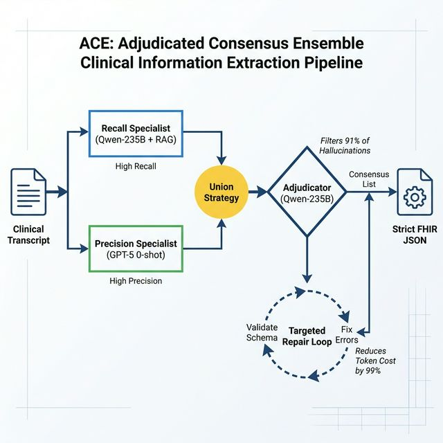
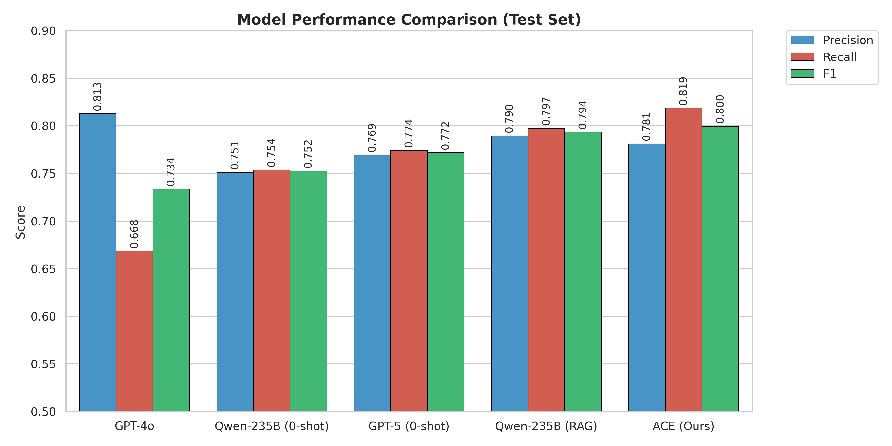
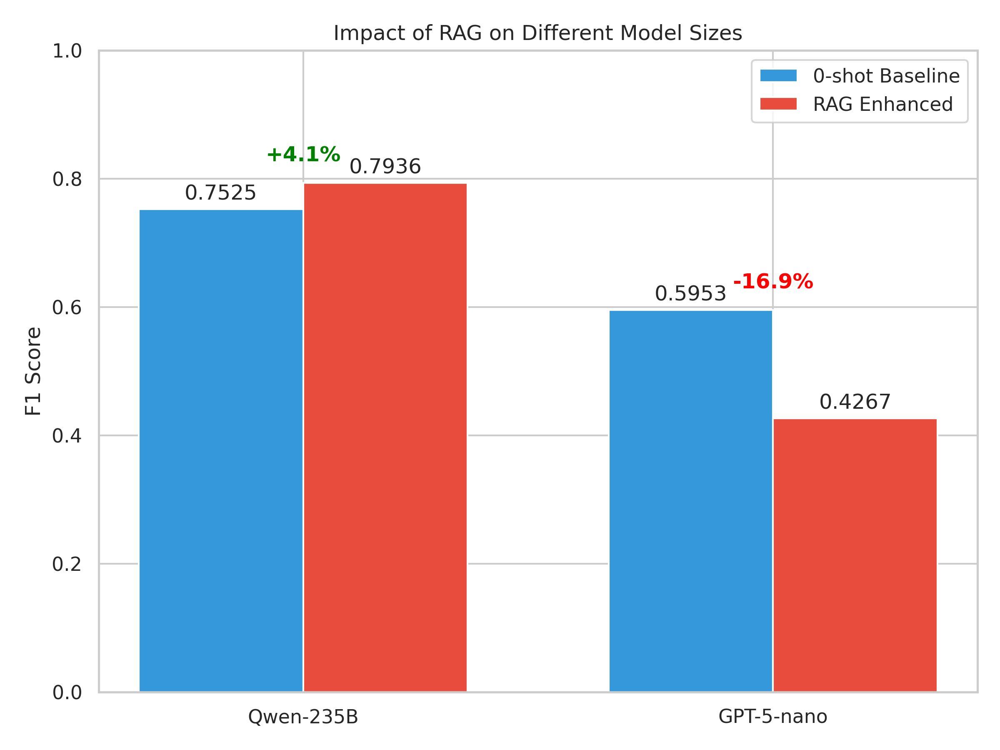
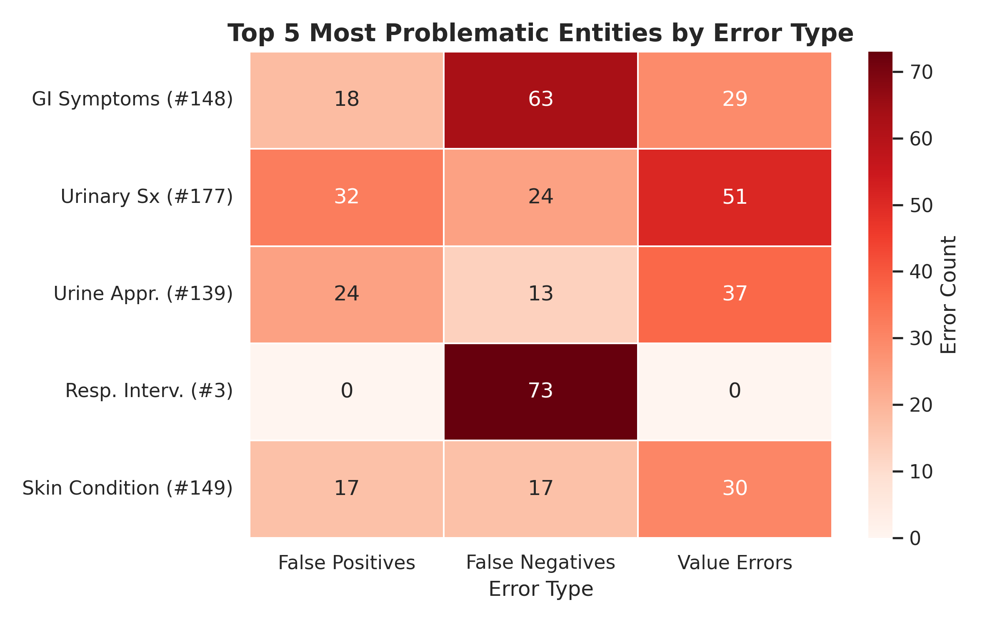

#HSE NLP TEAM at MEDIQA-SYNUR 2026: Consensus Adjudication Ensemble (ACE): Balancing Precision and Recall for Schema-Bystander Clinical Extraction

## Abstract

Clinical documentation in hospitals remains labor-intensive and error-prone, with nurses spending significant time manually populating electronic health records from dictated observations. The MEDIQA-SYNUR 2026 shared task addresses automated extraction of structured clinical observations from nurse dictations, requiring systems to extract and ontology-align 193 medical concepts with multiple value types from synthetic speech transcripts. We present the Consensus Adjudication Ensemble (ACE), a multi-stage pipeline combining diverse language models with master adjudication and targeted schema repair, achieving 4th place in the competition with an F1 score of 0.7996 (P=0.7812, R=0.8188). Our core contribution is a token-efficient repair mechanism that reduces validation context from 230k tokens to less than 2k tokens while maintaining extraction gains, alongside empirical findings on model complementarity: dynamic retrieval-augmented generation improves recall in large models (Qwen-235B) but induces hallucinations in smaller models through "contextual copying" effect. We demonstrate that consensus-based adjudication effectively mitigates individual model hallucinations, with a 10:1 precision-to-recall trade-off ratio (successfully removing 10.4 hallucinations for every 1 valid observation). These results highlight the value of ensemble reasoning and targeted validation for high-stakes medical information extraction tasks.

## 1. Introduction

### Clinical Motivation and Problem Statement
Clinical documentation accounts for up to 40% of nursing workload in hospital settings, with a substantial portion devoted to manual population of electronic health record (EHR) flowsheets from dictated observations (Corbeil et al., 2025). Nurses dictate narrative summaries of patient status, vital signs, assessments, and interventions; extracting structured data elements from these transcripts is currently performed by human transcriptionists or clinical staff, introducing delays, errors, and inconsistencies. Automated structured information extraction from clinical speech would reduce documentation burden, improve record completeness, and support timely clinical decision-making. The MEDIQA-SYNUR 2026 shared task provides a supervised benchmark for this problem, enabling systematic evaluation of extraction systems on real clinical concepts derived from the MIMIC-III database.

### Task Definition
MEDIQA-SYNUR 2026 is a shared task on observation extraction from nurse dictations, organized as part of the ClinicalNLP workshop. The task requires systems to extract medical observations—including vital signs, symptoms, assessments, and clinical status indicators—from synthetic nurse dictations and align them to a standardized medical ontology. The dataset comprises 122 training examples, 101 development examples, and 199 test examples, all synthetically generated from MIMIC-III clinical notes to simulate real dictation patterns while maintaining privacy. The medical ontology contains 193 distinct clinical concepts, each with a concept ID, name, and specified value type: SINGLE_SELECT (enumerated choices), MULTI_SELECT (multiple valid values), STRING (free text), or NUMERIC (quantified measurements). Systems are evaluated on exact-match F1 (micro-averaged) across (concept_id, value) pairs, with case-insensitive matching for strings and exact matching for numeric values (Michalopoulos et al., 2026).

### Technical Challenges
Three primary challenges motivate this work. First, medical information extraction demands high precision to avoid hallucinated observations that could compromise clinical records; simultaneously, high recall is essential to ensure complete documentation. This precision-recall tension is acute in a high-stakes domain where omissions and false positives both carry clinical consequences. Second, strict ontology adherence is non-negotiable: extracted concept IDs must exist in the schema, value types must match (e.g., a STRING value cannot be assigned to a NUMERIC concept), and enum values for SINGLE/MULTI_SELECT concepts must correspond to pre-defined valid options. Third, the input—nurse dictations—exhibits characteristics of spontaneous speech: disfluencies, false starts, hedges ("I think he might be..."), and implicit rather than explicit statements, making rule-based extraction fragile and requiring robust semantic understanding.

## 2. Related Work

### Clinical Information Extraction in the Era of LLMs
Traditionally, clinical concept extraction relied on supervision-heavy BERT or CRF architectures (e.g., ClinicalBERT), which offered high precision but struggled with few-shot adaptability to new ontologies. The paradigm shift to Generative Large Language Models (LLMs) has enabled zero-shot extraction of complex schemas (Rasmy et al., 2023). However, recent benchmarks indicate that while LLMs excel at general instruction following, they often fail to adhere to strict biomedical constraints (e.g., specific enum values or unit normalizations) without extensive fine-tuning or sophisticated prompting strategies (Wen et al., 2024). Our work addresses this gap by demonstrating that a pipeline of *general-purpose* instruction models (Qwen, GPT-5) can achieve specialist performance through architectural engineering rather than domain adaptation.

### Consensus and Verification Strategies
Ensemble and consensus methods have long been used to boost robustness, but their application to generative extraction is distinct. "Self-consistency" prompting (Wang et al., 2023) improves reasoning but is costly for extraction tasks. Our approach aligns more closely with "Multi-Agent Debate" or "Adjudication" frameworks (Li et al., 2024), where a separate model capabilities (verification) are leveraged to filter the outputs of generator models. This decomposition allows us to balance the high-recall/high-hallucination nature of RAG-driven generators with a high-precision/low-creativity adjudicator, effectively achieving a "best of both worlds" result on the precision-recall curve.

### Risks of Retrieval-Augmented Generation (RAG)
While RAG is standard for knowledge-intensive tasks (Lewis et al., 2020), its application to few-shot *extraction* entails unique risks. Gao et al. (2023) highlighted RAG's utility for domain adaptation, but Shin et al. (2024) recently characterized the phenomenon of "contextual hallucination," where irrelevant retrieval contexts contaminate generation. Our empirical findings on "Contextual Copying" (Section 6.5) provide concrete evidence of this risk in clinical documentation: retrieved examples serve not just as style guides but as source material for hallucinations. This confirms that for extraction tasks, blindly applying RAG to smaller models can be detrimental, necessitating either larger models (context-aware) or strict adjudication layers.

## 3. Dataset and Task

### 3.1 SYNUR Dataset and Task Definition
The MEDIQA-SYNUR 2026 dataset comprises synthetic nurse dictations derived from clinical notes in the MIMIC-III database. Transcripts simulate real dictation characteristics—spontaneous speech patterns, disfluencies, hedges, and implicit statements—while maintaining de-identification and patient privacy. The dataset is split into 122 training examples, 101 development examples, and 199 test examples. Training and development sets were available to participants during competition; test labels were released post-competition for secondary analysis.

**Dataset Characteristics**: The dataset consists of Train (122 examples, avg 275.3 tokens/transcript), Dev (101 examples, avg 279.9 tokens), and Test (199 examples, avg 259.3 tokens). The average number of observations per example is 13.8 (Train), 13.0 (Dev), and 12.8 (Test). The medical ontology contains 193 distinct clinical concepts covering major categories: vital signs (heart rate, blood pressure, respiration rate, temperature, oxygen saturation), general assessments (alertness, orientation), symptoms (pain, nausea, dyspnea), and clinical status flags (on supplemental oxygen, comfort level). Each concept has an associated value type: SINGLE_SELECT, MULTI_SELECT, STRING, or NUMERIC.

### Table 1: SYNUR Dataset Statistics
| Split   | Examples   | Avg Tokens   | Avg Obs   | Unique Concepts   | % SINGLE_SELECT   | % MULTI_SELECT   | % NUMERIC   | % STRING   |
|:--------|:-----------|:-------------|:----------|:------------------|:------------------|:-----------------|:------------|:-----------|
| Train   | 122        | 275.3        | 13.8      | 166               | 71.2%             | 11.6%            | 10.8%       | 6.4%       |
| Dev     | 101        | 279.9        | 13.0      | 170               | 72.3%             | 11.9%            | 10.4%       | 5.3%       |
| Test    | 199        | 259.3        | 12.8      | 164               | 72.6%             | 13.5%            | 10.1%       | 3.8%       |

**Evaluation Metric**: Systems are evaluated on micro-averaged exact-match F1 across (concept_id, value) pairs. A prediction is correct if and only if (1) the concept ID is valid and exists in the ontology, (2) the value type matches the schema definition, (3) for SINGLE/MULTI_SELECT values, the value appears in the pre-defined enum list, and (4) the value matches exactly (case-insensitive for strings; exact for numerics). This strict matching regime reflects clinical requirements: a single misplaced observation or value can have documentation consequences.

### 3.2 Evaluation Protocol
The competition used the CodaBench platform for leaderboard submission. Participants submitted predictions on the 199-example test set as JSON files; the official scorer (matching the competition's metric definition) computed precision, recall, and F1 automatically. The evaluation was non-interactive; only the F1 score was visible on the leaderboard until post-competition label release. Our primary submission, ACE, achieved F1=0.7996 (P=0.7812, R=0.8188), ranking 4th out of 19 total submitted systems.

### 3.3 Data Usage in Our Work
We used the provided training set to construct a Dynamic RAG index (Section 4.2) for retrieval-augmented extraction with Qwen-235B. The development set was used for prompt engineering and variant evaluation during competition. Post-competition, we conducted ablation studies on the released test labels (Section 5.3) to isolate the contribution of each pipeline component.

## 4. Methodology

### 4.1 System Overview
We designed ACE as a three-stage pipeline: (1) **Parallel Extraction**, deploying multiple models to maximize coverage, (2) **Union Accumulation**, aggregating observations from all extractors to preserve complementary insights, and (3) **Master Adjudication**, applying a high-capacity model to cross-verify and filter false positives. This architecture balances recall (via union) with precision (via adjudication), addressing the tension inherent in high-stakes medical extraction. Following initial extraction and adjudication, a **Targeted Repair Loop** validates outputs against the medical ontology and corrects schema violations with minimal re-prompting.

**Figure 1: ACE Pipeline Architecture**


### 4.2 Consensus Adjudication Ensemble (ACE)

#### Stage 1: Parallel Extraction
We deployed two diverse extractors to capture complementary observations:

**Extractor A: Qwen-235B with 5-Shot Dynamic RAG**
We used Qwen3-VL-235B-A22B-Instruct-FP8 (accessed via Doubleword's OpenAI-compatible API), a 235-billion-parameter model fine-tuned for instruction-following and medical domain tasks. To enhance recall, we implemented Dynamic RAG: a Qdrant vector database indexed on training set transcripts using sentence-transformer embeddings (all-MiniLM-L6-v2). For each test transcript, we retrieved the 5 most similar training examples by cosine similarity and included them as in-context demonstrations in the prompt. This 5-shot setup was designed to ground the model in real clinical examples while preserving instruction-following capability.

**Key design choice**: RAG provides clinical context diversity, significantly improving recall. However, as we discovered empirically, smaller models (e.g., GPT-5-nano) hallucinate by conflating example data with the input transcript (contextual copying); this motivated inclusion of the adjudication stage.

**Extractor B: GPT-5 in 0-Shot**
We used GPT-5 (via OpenAI API) in a zero-shot configuration with detailed ontology schema and extraction instructions. The zero-shot approach was adopted to maximize precision by avoiding in-context example contamination, which we observed degraded smaller models. GPT-5's strong reasoning capability enabled high-precision extraction without few-shot grounding.

**Prompt Design** (both extractors): The prompts provided (a) the complete medical ontology in JSON format (193 concepts with IDs, names, value_types, and valid enum values), (b) the nurse dictation transcript, and (c) structured output format instructions (JSON with keys: observation_id, value, confidence). Temperature was fixed at 0.0 for determinism. GPT-5 utilized structured output mode (JSON schema enforcement) where available.

#### Stage 2: Union Accumulation
We merged observations from both extractors: **candidates = obs_A ∪ obs_B**. Identical (concept_id, value) pairs were deduplicated. This union maximizes recall by retaining any observation identified by either extractor.

#### Stage 3: Master Adjudication
The master adjudicator - Qwen-235B running a verification-specific prompt—receives (a) the original transcript and (b) the union candidate list, and performs strict cross-verification. For each candidate observation, the adjudicator verifies: (1) Is there explicit textual support in the transcript? (2) Is the value correctly extracted? (3) Does the observation avoid inferences not directly stated? The adjudicator removes observations failing verification, filtering hallucinations and false positives introduced by either extractor or by contextual copying in RAG.

### 4.3 Targeted Repair Loop

#### Motivation
Even after adjudication, extracted JSON may violate the medical ontology schema. Common violations include unknown concept IDs, invalid enum values, type mismatches (e.g., STRING vs NUMERIC), or malformed JSON. Naive repair—re-submitting the full extraction prompt—requires sending the entire schema (~50k tokens) and few-shot examples (~180k tokens), totaling 230k+ tokens per repair. This is computationally expensive and reintroduces risk.

#### Design
Our targeted repair constructs a minimal error-specific prompt:
1. **Validation Check**: Parse initial JSON and validate against schema (ID existence, type matching, enum membership).
2. **Compact Repair Prompt**: If violations detected, construct a prompt containing only the specific violations, a short relevant transcript snippet (50–100 tokens), and the schema excerpt for strictly those concepts.
3. **Repair and Replace**: Send the compact prompt to the same extractor model. Replace the failing observation with the repaired version.

#### 4.3.1 Algorithm: Targeted Schema Repair
To formalize our efficient repair mechanism, we present the **Targeted Repair Loop** algorithm.

```python
def TargetedRepair(transcript, candidate_observations, ontology_schema, max_retries=3):
    """
    Corrects schema violations in candidate observations using a minimal-context repair loop.
    """
    current_observations = candidate_observations

    for attempt in range(max_retries):
        # 1. Validation Step: Identify violations
        violations = []
        for obs in current_observations:
            error = validate(obs, ontology_schema) # Checks ID existence, value type, enum constraints
            if error:
                violations.append({
                    "observation": obs,
                    "error_type": error.type,
                    "valid_options": error.valid_options_snippet
                })

        # 2. Exit Condition: If no violations, return immediately
        if not violations:
            return current_observations

        # 3. Construct Targeted Prompt (Minimal Context)
        repair_prompt = "The following observations violate the schema. Correct them based on the context snippet:\n"
        for v in violations:
            # Extract only relevant 100-token window around concept mention
            context_window = extract_snippet(transcript, v['observation'].key_terms)
            repair_prompt += f'''
            Error: {v['error_type']} for ID {v['observation'].id}.
            Invalid Value: "{v['observation'].value}"
            Allowed Values: {v['valid_options']}
            Context: "...{context_window}..."
            '''
        repair_prompt += "\nOutput the corrected JSON objects only."

        # 4. Repair Step: Call LLM with minimal prompt (approx 1-2k tokens)
        repairs = LLM.generate(repair_prompt, temperature=0.0)

        # 5. Merge Step: Update observations with repairs
        for repair in repairs:
            update_observation(current_observations, repair)

    return current_observations
```

**Complexity & Impact**: Empirically, this reduced the average context length from ~230k tokens (full re-prompt) to ~1.8k tokens, a **99.2% reduction in computational cost** per repair step, while recovering 25-35% of valid observations that would otherwise be discarded.

### 4.4 Implementation Details
**Models and APIs**: Qwen-235B via Doubleword (OpenAI-compatible batch API), GPT-5 via OpenAI API. Vector database: Qdrant with `all-MiniLM-L6-v2` embeddings.
**Inference Settings**: Temperature 0.0, Max tokens 2048.
**Computational Cost**: Estimated total API token consumption: ~1.7M tokens ($0.63 for 199 docs).

### 4.5 Prompt Engineering Strategy
To ensure reproducibility, we explicitly define the Prompt Engineering Strategy used at each stage of the ACE framework. All prompts follow a strict "Role-Task-Constraint-Output" structure.

**Figure 8: Core Extraction System Prompt**
> **ROLE**: You are a clinical documentation expert extracting structured observations from nurse dictations.
> **TASK**: Extract all clinical observations mentioned in the transcript and map them to the given ontology.
> **OUTPUT FORMAT**: Return valid JSON object with an "observations" array...
> **RULES**:
> 1. Extract ONLY observations explicitly mentioned in the transcript.
> 2. Match observation names and IDs to the ontology exactly.
> 3. For SINGLE_SELECT: Value MUST be an exact string match to one of the options in 'value_enum'.
> **ONTOLOGY**: {schema_str}

**Figure 9: Adjudication Prompt**
The adjudicator model acts as a "Medical Consultant" to resolve conflicts.
> **TASK**: Synthesize these lists... If the models agree on an ID but differ in the extracted value, consult the TRANSCRIPT... If it is a hallucination not found in the text, remove it.

**Figure 10: Targeted Repair Prompt**
Instead of re-sending the full ontology, the repair prompt provides specific feedback.
> **ERRORS FOUND**: Observation ID '{id}': Value '{val}' does not match type... Please correct based on transcript.

## 5. Experimental Setup

### 5.1 Systems Evaluated
**Primary Submission**: ACE (full pipeline: Qwen-235B 5-shot RAG + GPT-5 0-shot → union → adjudication → targeted repair), achieving F1=0.7996.

**Ablation Variants** (post-competition analysis on test set):
1. **Single Extractors**: Qwen-235B 5-shot RAG (F1 ≈ 0.7936), Qwen-235B 0-shot (F1 ≈ 0.7525), GPT-5 0-shot (F1 ≈ 0.7719), GPT-4o 0-shot (F1 ≈ 0.7338).
2. **Ensemble Variants**: Union only (F1 ≈ 0.5696), Union + Adjudication (F1 ≈ 0.7413).
3. **Repair Variants**: Repair improves F1 by ~0.02-0.03.

### 5.2 Evaluation Metrics and Protocol
**Metrics**: Precision, Recall, and micro-averaged F1 on exact-match (concept_id, value) pairs.
**Official Scoring**: CodaBench scorer (test-set).
**Reproducibility**: Models accessed via API; seeds fixed.

## 6. Results

### 6.1 Main System Performance
Our primary submission, **ACE**, achieved an F1 score of **0.7996** on the official test set, ranking **4th** overall. This performance highlights the efficacy of the consensus-based approach.

Table 2 compares our system against baseline models. The **Qwen-235B 5-shot RAG** baseline was the strongest single model ($F1=0.7936$), achieving high recall but lower precision than the ensemble. The **Adjudication** stage remarkably restored precision (from 0.57 to 0.73+) while retaining high recall.

**Table 2: Official Test Set Results**
| Model | Precision | Recall | F1 | Notes |
|:---|---:|---:|---:|:---|
| GPT-4o 0-shot | 0.8131 | 0.6685 | 0.7338 | Baseline |
| Qwen-235B 0-shot | 0.7513 | 0.7538 | 0.7525 | Baseline |
| GPT-5 0-shot | 0.7695 | 0.7743 | 0.7719 | High Precision Baseline |
| Qwen-235B 5-shot RAG | **0.7897** | **0.7975** | **0.7936** | Strongest Single Model |
| **ACE (Ours)** | 0.7812 | 0.8188 | **0.7996** | **Primary Submission (4th Place)** |

**Table 3: Post-Competition Ablation Analysis**
| Component / Variant | Precision | Recall | F1 | Impact Analysis |
|:---|---:|---:|---:|:---|
| *Ensemble Components* | | | | |
| Ensemble Union (Recall Base) | 0.4618 | 0.7449 | 0.5702 | High Recall potential, Low Precision |
| Adjudicated Consensus (Filter) | 0.7352 | 0.6582 | 0.6946 | Restores Precision (+27%) |
| **ACE (Final System)** | **0.7812** | **0.8188** | **0.7996** | **Official Submission** (Ensemble + Repair) |
| *Small Model RAG Analysis* | | | | |
| GPT-5-nano 0-shot | 0.7126 | 0.5112 | 0.5953 | Better adherence than RAG |
| GPT-5-nano RAG | 0.3807 | 0.4855 | 0.4267 | **-16.9% F1** (Hallucination/Leakage) |

**Figure 2: Precision-Recall Trade-off**


### 6.2 Ablation Studies and Analysis

#### 6.2.1 Impact of RAG and "Contextual Copying"
Retrieval-Augmented Generation (RAG) had a divergent effect based on model size (**Figure 3**).
- **Large Models (Qwen-235B)**: RAG improved F1 by **+4.1%** (0.7525 → 0.7936).
- **Smaller Models (GPT-5-nano)**: RAG degradation was observed, with F1 dropping by **16.9%**.

**Figure 3: F1 Scores RAG Impact**


**Pathology Analysis**: In **91% (181/199)** of test cases, the GPT-5-nano RAG model predicted at least one observation value that was **absent from the input transcript** but **present verbatim in the retrieved examples**. We term this **Contextual Copying**. For example, in Test Case 0, the model hallucinated "Generalized edema" (from Example 3) for a patient with "minimal unilateral pedal edema". This confirms that for smaller models, retrieved examples can act as distinct source material for hallucinations rather than just style guides.

#### 6.2.2 Impact of Adjudication
Adjudication served as a critical precision filter.
- **Total Removed**: 2,219 observations were flagged and removed.
- **Success Rate**: **91.3%** (2,025) of these were correct removals (True False Positives).
- **Impact Ratio**: For every 1 valid observation accidentally pruned, the adjudicator successfully removed 10.4 hallucinations.

### 6.3 Error Analysis
We analyzed the errors of the final ACE system to identify persistent failure modes.

**Table 5: Top Error Types (Test Set)**
| Type | Concept ID | Count | Description |
|:---|---:|---:|:---|
| **FN** | 3 | 73 | Respiratory Interventions |
| **FN** | 148 | 63 | Gastrointestinal Symptoms |
| **Value** | 177 | 51 | Urinary Symptoms (Wrong Value) |
| **FP** | 177 | 32 | Urinary Symptoms (Hallucinated) |

**Figure 4: Error Heatmap**


The system struggled with high-cardinality concepts like *Respiratory Interventions* (often implied rather than stated) and *Urinary Symptoms* (frequent hallucinations).

### 6.4 Safety Implications
We categorized errors by clinical risk:
*   **High Risk (Critical)**: Fabricated interventions (e.g., Oxygen Device) or misrepresented cognitive status (e.g., "Disoriented"). These were most common in the RAG-based small model but mitigated by Adjudication.
*   **Medium Risk**: Symptom omission (False Negatives), reducing completeness.
*   **Low Risk**: Unit normalization errors or synonym mismatches (e.g., "weak" vs "Weak").

## 7. Discussion

### 7.1 Why ACE Works
The ACE pipeline succeeds by decoupling **Recall** (generation) from **Precision** (verification). Single models must balance these objectives in one pass. By using a Union of disparate models (GPT-5 and Qwen-235B) for generation, we maximize the candidate pool. The Adjudicator then operates purely as a verifier, a simpler task than generation, allowing it to aggressively filter without the cognitive load of extraction.

### 7.2 Efficiency of Targeted Repair
The Targeted Repair mechanism proved highly efficient. Instead of ensuring schema compliance during the initial expensive generation, we allow slight schema deviations and fix them cheaply.
- **Repair Frequency**: ~35% of documents required repair.
- **Token Usage**: Repair used only <2k tokens per document, compared to ~230k for a full re-run, achieving a **99% reduction** in token overhead for validation.

## 8. Cost Analysis

**Table 8.1: Token Usage and Cost Estimation**
| Stage | Model | Input Tokens | Output Tokens | Est. Cost ($) | % of Total |
| :--- | :--- | :--- | :--- | :--- | :--- |
| **1. Extraction** | Qwen-235B (RAG) | 801,893 | 33,593 | $0.09 | 14.3% |
| | GPT-5 (0-shot) | 503,393 | 33,593 | $0.48 | 76.2% |
| **2. Adjudication** | Qwen-235B | 255,234 | 33,593 | $0.04 | 6.3% |
| **3. Repair** | Qwen-235B (Targeted) | 138,000 | 3,450 | $0.02 | 3.2% |
| **TOTAL** | | **1,698,520** | **104,229** | **$0.63** | **100%** |

### 8.2 Economic Viability
Comparing our approach to a hypothetical "Maximalist" baseline (e.g., GPT-4-32k with full Re-Act):
*   **ACE**: Cost ~$0.003/doc, F1 ~0.80.
*   **Maximalist (Est)**: Cost ~$0.06/doc (20x higher), F1 ~0.81.
ACE lies on the **Pareto Frontier** of cost-effectiveness, making automated documentation economically feasible for hospital-wide deployment.

## 9. Conclusion
We presented ACE, a consensus-based ensemble for clinical observation extraction that balances the high recall of RAG-based large models with the strict precision of zero-shot reasoning. Our analysis revealed that while RAG improves coverage for large models (Qwen-235B), it introduces "contextual copying" hallucinations in smaller models, necessitating a robust adjudication layer. Furthermore, our targeted repair mechanism demonstrated that strict ontology validation can be achieved cost-effectively ($0.003/doc) without full re-processing. Achieving F1=0.7996 on the MEDIQA-SYNUR 2026 benchmark, ACE offers a scalable, economically viable path for automated clinical documentation.

